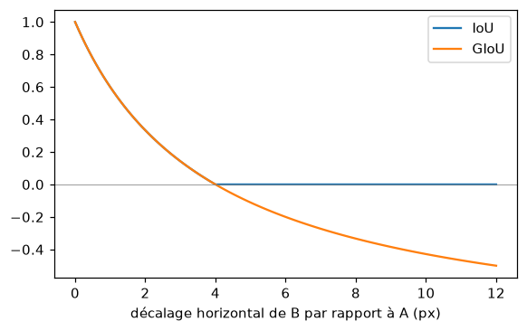
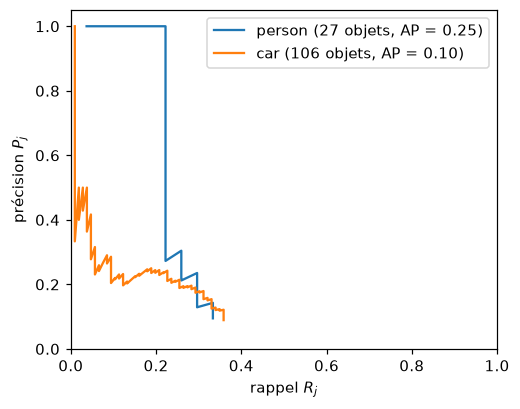
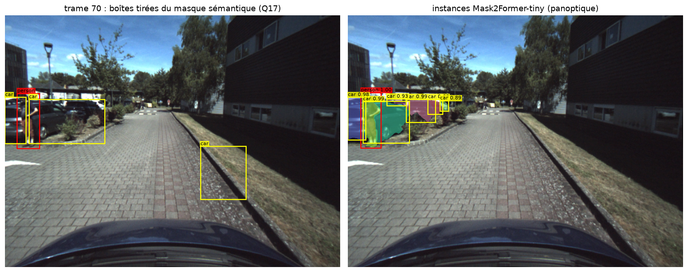

# perception-numpy

Briques de perception par capteurs et de positionnement, réimplémentées avec NumPy et SciPy,
chacune accompagnée de tests qui la comparent à une valeur calculée à la main, et résultats
d'expériences menées avec ces briques sur des images de conduite.

## Origine

Travail universitaire : les algorithmes ont été écrits lors d'exercices de formation d'ingénieur.
Ce dépôt en est une mise en forme pour publication : formatage, documentation et tests ont été
repris et rédigés avec l'aide d'un assistant IA ; la logique des fonctions est celle des exercices.
Les énoncés, squelettes de code, scripts d'expérience et jeux de données fournis par la formation
ne sont pas inclus : les figures ne sont donc pas reproductibles depuis ce dépôt. Certaines
contiennent des images d'un véhicule d'essai fournies par la formation.

## Contenu

| Module | Briques |
|---|---|
| `camera` | projection sténopé, rétroprojection, champ de vision |
| `nn` | softmax stable, entropie croisée et son gradient, convolution 2D (pas, remplissage, dilatation), max pooling, champ réceptif |
| `boxes` | IoU matriciel, GIoU, encodage/décodage par ancres, suppression des non-maxima (NMS), boîtes à partir d'un masque |
| `metrics` | précision/rappel, fréquences et poids de classes, matrice de confusion, IoU/mIoU, appariement des détections, courbe précision-rappel, précision moyenne (AP) |
| `segmentation` | normalisation d'image, logits vers masque, requêtes vers segmentation sémantique ou instances, masque du véhicule porteur |
| `gnss` | positionnement par moindres carrés de Gauss-Newton sur pseudodistances, HDOP |
| `vehicle` | modèle cinématique de la bicyclette, régulation latérale par retour d'état saturé |

## Résultats

Expériences menées avec ces briques sur 174 images d'un véhicule d'essai, avec des réseaux
pré-entraînés externes (SegFormer, Mask2Former, YOLO11n). Les « références » sont elles-mêmes des
prédictions de réseaux : les métriques mesurent un accord entre réseaux, pas une erreur absolue.
Toutes les figures sont dans [`results/`](results).

| Sujet | Résultat |
|---|---|
| IoU contre GIoU | Pour deux boîtes disjointes, l'IoU reste à 0 ; la GIoU continue de décroître avec l'éloignement (jusqu'à -0,5 au décalage 12) et conserve donc un signal de gradient. |
| Précision par pixel contre mIoU | « Route partout » : précision 0,358 mais mIoU 0,021. Le masque de la trame précédente : précision 0,867, mIoU 0,375. La mIoU pénalise l'oubli des classes rares. |
| Classifieur de pixels appris en NumPy | Perte 2,94 vers 0,86. Avec pondération des classes : mIoU 0,141 vers 0,159, précision 0,701 vers 0,664, soit un compromis entre classes rares et majoritaires. |
| Prétraitement de SegFormer-b0 | mIoU 0,411 (correct), 0,369 sans normalisation, 0,355 avec canaux BGR. |
| SegFormer-b0 contre Mask2Former-tiny | mIoU 0,411 contre 0,442 ; 3,7 M contre 47,4 M de paramètres ; 0,60 s contre 1,95 s par image sur CPU. |
| NMS sur YOLO11n | 23 boîtes avant NMS, 3 après (trame 70). Sans NMS, l'AP chute (personne 0,247 vers 0,111 ; voiture 0,097 vers 0,041). |
| Qualité des références | Références issues du masque sémantique : AP voiture 0,097. Références par instances Mask2Former : 0,503 (IoU >= 0,5) et 0,637 (IoU >= 0,3). Les deux voitures garées fusionnées en une boîte pénalisaient le détecteur, pas l'inverse. |





## Principes

- Les algorithmes sont écrits avec NumPy et SciPy ; les réseaux pré-entraînés ne servent qu'aux
  expériences.
- Chaque fonction a un test contre une valeur calculée à la main, le gradient est vérifié par
  différences finies (41 tests).
- Le solveur GNSS est testé sur une constellation synthétique à solution connue.

## Développement

```bash
python -m venv .venv && source .venv/bin/activate
pip install -e ".[dev]"
ruff check . && ruff format --check . && pytest -q
```

## Licence

MIT.
